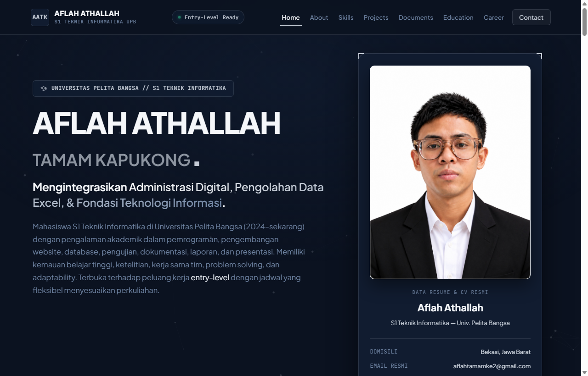
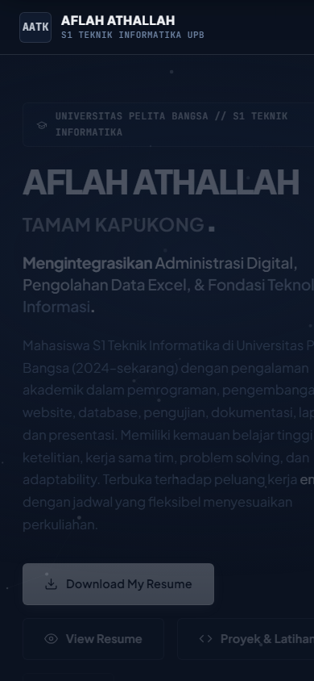

# 🌟 Personal Branding Portfolio — Aflah Athallah Tamam Kapukong

<div align="center">

  [](https://developer.mozilla.org/en-US/docs/Web/HTML)
  [](https://developer.mozilla.org/en-US/docs/Web/CSS)
  [](https://developer.mozilla.org/en-US/docs/Web/JavaScript)
  [](https://www.python.org/)
  [](https://www.mysql.com/)
  [](https://office.com)
  [](https://abcdeflahhh.github.io/website-portofolio/)
  []()

  <h3>Personal Branding & Portofolio Mahasiswa S1 Teknik Informatika</h3>
  <p><strong>Universitas Pelita Bangsa — Angkatan 2024 s.d. Sekarang</strong></p>

  <br>

  [](https://abcdeflahhh.github.io/website-portofolio/)

  <p>
    🔗 <strong>Tautan Langsung:</strong> <a href="https://abcdeflahhh.github.io/website-portofolio/"><strong>https://abcdeflahhh.github.io/website-portofolio/</strong></a>
  </p>

  <p>
    <a href="#-pratinjau-tampilan-website">Pratinjau</a> •
    <a href="#-fitur-utama-website">Fitur Utama</a> •
    <a href="#-showcase-proyek-akademik-terperinci">Proyek Akademik</a> •
    <a href="#-katalog-keahlian-teknis">Keahlian</a> •
    <a href="#-panduan-publikasi-ke-github-pages-gratis-hosting">Panduan Hosting</a> •
    <a href="#-kontak--informasi-resmi">Kontak</a>
  </p>

</div>

---

## 📖 Ringkasan Proyek

Website ini adalah platform **Personal Branding & Portofolio Profesional** untuk **Aflah Athallah Tamam Kapukong**, seorang mahasiswa S1 Teknik Informatika di Universitas Pelita Bangsa. Website ini dirancang untuk menampilkan profil akademik, kompetensi teknis, penugasan perkuliahan, dan dokumen CV/Resume resmi dengan standar visual kelas atas (*Modern Luxury Midnight Blue & Silver*).

Dibangun secara murni menggunakan **Vanilla Web Stack (HTML5 Semantik, CSS3 Modern, dan Vanilla JavaScript ES6+)** tanpa ketergantungan framework pihak ketiga yang berat, menghasilkan pengalaman pengguna yang sangat cepat (*ultra-fast loading*), ringan, responsif, dan aksesibel di seluruh perangkat desktop, laptop, tablet, maupun smartphone.

---

## 📸 Pratinjau Tampilan Website

<div align="center">

### 💻 Tampilan Desktop


<br/><br/>

### 📱 Tampilan Mobile Responsif


</div>

---

## 🎨 Konsep Desain & Identitas Visual

- **Palet Warna Utama:**
  - `Midnight Blue (#0B1220)` — Latar belakang utama bernuansa eksklusif, formal, dan tenang.
  - `Deep Navy (#111C30, #152238)` — Kontainer kartu elevated dengan kontras optimal dan kedalaman visual.
  - `Silver (#C5CCD6)` — Aksen garis tipis (*hairline borders*), ikon, dan pendaran aksen mewah.
  - `Cool White (#F5F7FA)` — Tipografi judul utama dan keterbacaan teks informasi.
  - `Steel Blue (#7186A5)` — Subjudul, teks monospaced, dan label metadata.
  - `Emerald Status (#34D399)` — Indikator status ketersediaan kerja aktif (*Entry-Level Ready*).
- **Tipografi:**
  - **Heading & UI:** `Plus Jakarta Sans` (Sans-serif kontemporer yang tegas, modern, dan profesional).
  - **Metadata & Kode:** `JetBrains Mono` (Font monospaced presisi tinggi khas dunia informatika).
- **Karakter Visual:** Bersih, terstruktur rapi, proporsional, bebas ornamen berlebihan, dan tidak menggunakan persentase kemampuan fiktif.

---

## 🌟 Fitur Utama Website

### 1. Header Navigasi Dinamis & Utility Bar
- **Scroll Progress Indicator:** Garis perak tipis di bagian teratas layar yang memanjang secara proporsional sesuai progres membaca halaman (0% s.d. 100%).
- **Ambient Canvas Background:** Latar belakang partikel geometris halus interaktif yang bergerak tenang dan merespons kursor mouse secara halus.
- **Brand Identity:** Monogram perak `AATK` bersanding dengan nama lengkap `AFLAH ATHALLAH` dan subjudul `S1 TEKNIK INFORMATIKA UPB` dengan jarak vertikal yang rapi.
- **Scroll Spy Navigation:** Indikator tautan menu aktif secara otomatis mengikuti posisi bagian (*section*) yang sedang dilihat.
- **Mobile Drawer Menu:** Pada layar ponsel/tablet (`≤ 1040px`), menu berganti menjadi laci navigasi hamburger yang dapat ditutup via klik tautan atau tombol `Escape`.

### 2. Hero Section (Halaman Penyambutan)
- **Komposisi Dua Kolom Seimbang:**
  - **Kolom Kiri:** Badge institusi UPB, nama lengkap berbobot kuat, headline nilai integrasi (Administrasi Digital, Pengolahan Data Excel, & Fondasi IT), ringkasan naratif autentik, baris status meta, serta tombol aksi cepat (*Download Resume*, *View Resume*, *Proyek*, *Keahlian*).
  - **Kolom Kanan:** Bingkai arsitektur perak (*corner brackets*) yang membingkai **foto profil resmi beresolusi tinggi** dalam rasio 3:4 (`object-fit: contain`) sehingga kepala, rambut, kacamata, dan setelan jas hitam tampak utuh 100%. Dilengkapi kartu spesifikasi domisili, email, nomor kontak, status ketersediaan entry-level, dan badge highlight keahlian praktis yang bebas halangan.

### 3. About Me & Tiga Pilar Nilai Kerja
- Narasi personal branding autentik berbasis riwayat akademik mahasiswa Universitas Pelita Bangsa (2024 s.d. sekarang).
- **Tiga Pilar Kompetensi:**
  1. *Ketelitian & Akurasi Data:* Standarisasi format, verifikasi ganda, dan integritas data input.
  2. *Pemecahan Masalah & Logika Algoritmik:* Mengurai masalah kompleks menjadi solusi terstruktur.
  3. *Adaptabilitas & Kolaborasi Tim:* Kecepatan mempelajari ekosistem teknologi baru dan komunikasi terbuka.

### 4. Interactive Skills Explorer
- **Sistem Filter Tab Dinamis:** Memungkinkan recruiter menyaring keterampilan teknis dalam 6 kategori:
  - *Semua Kategori*
  - *A. Office & Administration* (Word, Excel, PowerPoint, Microsoft 365, Laporan & Presentasi)
  - *B. Data Processing & Excel Formulas — Kategori Unggulan* (SUM, AVERAGE, IF, COUNTIF, VLOOKUP/XLOOKUP, PivotTable, Data Validation, Charts, Data Cleaning)
  - *C. Programming & Web Development* (HTML5, CSS3, JavaScript ES6+, PHP, Python 3, Java, C/C++)
  - *D. Relational Database* (SQL, MySQL, phpMyAdmin, Perancangan ERD)
  - *E. Tools & Desain Grafis* (VS Code, Git, GitHub, Figma, Canva, Tools AI Produktivitas)
  - *F. Professional & Soft Skills* (Komunikasi, Kerja Sama Tim, Manajemen Waktu, Problem Solving, Dokumentasi)
- Setiap kartu memuat **Konteks Akademik Riil** penerapan ilmu tanpa angka persentase fiktif.

### 5. Academic Project Showcase & Detail Modal
- Seluruh proyek disajikan transparan sebagai **penugasan perkuliahan dan latihan mandiri** di UPB.
- Dilengkapi tab filter kategori (*Semua, Programming, Web, Database, Data*).
- **Jendela Modal Studi Kasus Aksesibel:** Menampilkan arsitektur kode, latar belakang penugasan, dan pengujian program dengan dukungan keyboard `Escape`, backdrop blur, dan *focus trap*.

### 6. Document Center (Pusat Unduhan Dokumen Resmi)
- Menyediakan 2 dokumen terpisah dalam format PDF standar:
  - **Curriculum Vitae (CV):** Berkas profil, pendidikan, dan pengalaman komprehensif.
  - **One-Page Resume:** Ringkasan eksekutif 1 halaman siap cetak.
- Masing-masing dokumen memiliki tombol **View** (membuka di tab baru via `target="_blank"`) dan tombol **Download** langsung menggunakan path relatif (`cv-aflah.pdf` dan `resume-aflah.pdf`).

### 7. Education & Organizational Timeline
- Desain *timeline tree* bercabang dua kolom:
  - **Pendidikan Formal:** Universitas Pelita Bangsa (2024–Sekarang), SMAN 1 Cikarang Pusat, SMPIT Al-Ichwan, SDN 1 Sertajaya 05.
  - **Pengalaman Organisasi:** OSIS, Pramuka, Rohis, dan Kepanitiaan Acara Sekolah.

### 8. Career Interests & Contact Hub
- Menampilkan target karier realistis: *IT Support, Data Entry / Spreadsheet Specialist, Junior Web Developer Assistant, Digital Administrative Support*.
- **Saluran Kontak Resmi:**
  - Email: `aflahtamamke2@gmail.com` dilengkapi tombol salin ke clipboard dengan tooltip status *"Berhasil Disalin!"*.
  - WhatsApp: Tautan langsung ke `wa.me/628129529495`.
  - Formulir pengiriman pesan dengan validasi format email yang menghubungkan langsung ke aplikasi pengirim email (*mailto bridge*).
- **Floating Back-to-Top Button:** Tombol melayang di pojok kanan bawah dengan transisi halus saat halaman digulir.

---

## 🛠️ Showcase Proyek Akademik Terperinci

| No | Nama Proyek | Kategori | Teknologi | Fokus Pembelajaran & Implementasi |
| :-: | :--- | :--- | :--- | :--- |
| **1** | **Kalkulator Interaktif Terminal Python** | Programming & CLI | Python 3, CLI, Exception Handling | Pembuatan modul kalkulator interaktif CLI dengan fungsi modular terpisah serta penanganan kesalahan eksplisit `ValueError` dan `ZeroDivisionError`. |
| **2** | **Website Portofolio Responsif Midnight Silver** | Web Development | HTML5, CSS3, Vanilla JS, Canvas API | Pembangunan website personal branding responsif dengan estetika Midnight Blue & Silver, navigasi dinamis, modal dialog, dan performa tinggi. |
| **3** | **Aplikasi Web CRUD Berbasis PHP & MySQL** | Web Development | PHP, MySQL, Apache, HTML/CSS Forms | Latihan pengelolaan data dinamis (Create, Read, Update, Delete) dengan sanitasi form dan koneksi database di lingkungan server lokal. |
| **4** | **Desain & Query Relasional Basis Data** | Database | SQL, MySQL DBMS, phpMyAdmin, ERD | Perancangan skema relasi tabel, penetapan Primary/Foreign Key, serta eksekusi query relasional kompleks (`INNER JOIN`, `GROUP BY`, `HAVING`). |
| **5** | **Automasi Lembar Kerja & Pengolahan Data Excel** | Data & Office | Microsoft Excel, Formulas, PivotTable | Automasi rekapan data administrasi menggunakan formula `IF` bertingkat, `VLOOKUP`/`XLOOKUP`, `SUMIF`/`COUNTIF`, dan visualisasi PivotTable. |
| **6** | **Dokumentasi Proyek & Presentasi Tim** | Data & Dokumentasi | Microsoft Word, PowerPoint, Soft Skills | Penyusunan laporan teknis terstruktur dengan standarisasi penomoran/daftar isi serta materi presentasi slide untuk pemaparan di hadapan audiens. |

---

## 📂 Struktur Direktori Repositori

```text
website-portofolio/
├── index.html                           # Halaman utama, struktur semantik HTML5, meta SEO & Open Graph
├── style.css                            # Seluruh styling, CSS Variables, responsive grid, dan keyframes
├── script.js                            # Logika interaktif: canvas, filter tab, modal, clipboard, progress bar
├── profile-aflah.jpg                    # Foto profil profesional resmi resolusi tinggi (rasio 3:4)
├── profile-aflah.png                    # Salinan identik format PNG untuk kompatibilitas aset
├── preview-website.png                  # Tangkapan layar pratinjau desktop resolusi tinggi
├── preview-mobile.png                   # Tangkapan layar pratinjau mobile responsif
├── cv-aflah.pdf                         # Dokumen Curriculum Vitae resmi terverifikasi (PDF)
├── resume-aflah.pdf                     # Dokumen Executive One-Page Resume terverifikasi (PDF)
├── CV_Aflah_Athallah_Tamam_Kapukong.pdf # Berkas dokumen pendukung portofolio
├── .gitignore                           # Pengecualian file sistem cache (Thumbs.db, .DS_Store, logs)
└── README.md                            # Dokumentasi lengkap repositori proyek
```

---

## 💻 Panduan Menjalankan Proyek Secara Lokal

Jika Anda ingin menjalankan atau menguji website ini di komputer lokal:

### Prasyarat:
- Peramban web modern (Google Chrome, Microsoft Edge, Mozilla Firefox, atau Safari).
- Opsional: Visual Studio Code dan Git.

### Langkah-Langkah:
1. **Clone Repositori:**
   ```bash
   git clone https://github.com/Abcdeflahhh/website-portofolio.git
   ```
2. **Masuk ke Folder Proyek:**
   ```bash
   cd website-portofolio
   ```
3. **Buka Website:**
   - Cukup klik ganda pada file `index.html` di File Explorer, atau
   - Buka folder di Visual Studio Code, klik kanan pada file `index.html`, lalu pilih **"Open with Live Server"**.

---

## 🌐 Panduan Publikasi ke GitHub Pages (Gratis Hosting)

Website ini bersifat statis murni tanpa dependensi backend sehingga dapat langsung diaktifkan secara gratis melalui **GitHub Pages**:

1. Pastikan seluruh file di dalam folder `website-portofolio` sudah terunggah ke repositori GitHub Anda (`https://github.com/Abcdeflahhh/website-portofolio`).
2. Masuk ke halaman repositori di browser, lalu klik tab **Settings** (ikon roda gigi di menu atas).
3. Pada bilah navigasi sebelah kiri, klik menu **Pages**.
4. Di bagian **Build and deployment > Branch**:
   - Pilih branch: **`main`**
   - Pilih folder: **`/ (root)`**
   - Klik tombol **Save**.
5. Tunggu sekitar 1–2 menit hingga proses deployment selesai.
6. Website portofolio Anda resmi tayang online dan dapat diakses publik melalui URL:
   👉 **`https://abcdeflahhh.github.io/website-portofolio/`**

---

## ♿ Aksesibilitas & Kualitas Teknis

- **Keyboard Accessible:** Seluruh navigasi, tombol, kartu, dan formulir dapat diakses penuh menggunakan tombol `Tab` dan `Enter` dengan indikator fokus `:focus-visible` yang jelas.
- **Prefers-Reduced-Motion:** Menghormati pengaturan pengguna dengan mematikan animasi transform/kanvas secara otomatis bagi perangkat dengan fitur *reduce motion* aktif.
- **Zero Heavy Dependencies:** Nol ketergantungan framework berat (React, Vue, Bootstrap, Tailwind, atau jQuery), memastikan waktu render instan (*First Contentful Paint < 0.5s*).
- **Path Relatif Murni:** Seluruh aset gambar, dokumen PDF, stylesheet, dan skrip menggunakan path lokal relatif (`profile-aflah.jpg`, `resume-aflah.pdf`, dll.), mencegah error 404 saat di-hosting di subpath domain GitHub Pages.

---

## 📬 Kontak & Informasi Resmi

Jika Anda memiliki pertanyaan seputar proyek ini, tawaran kolaborasi akademik, atau peluang kerja *entry-level*, silakan hubungi:

- **Nama Lengkap:** Aflah Athallah Tamam Kapukong
- **Status Akademik:** Mahasiswa S1 Teknik Informatika (Universitas Pelita Bangsa, 2024–Sekarang)
- **Domisili:** Bekasi, Jawa Barat, Indonesia
- **Email:** [aflahtamamke2@gmail.com](mailto:aflahtamamke2@gmail.com)
- **WhatsApp:** [+62 812-9529-495](https://wa.me/628129529495)
- **Repositori GitHub:** [github.com/Abcdeflahhh/website-portofolio](https://github.com/Abcdeflahhh/website-portofolio)

---

<div align="center">

  [](https://abcdeflahhh.github.io/website-portofolio/)
  [](https://github.com/Abcdeflahhh)
  [](mailto:aflahtamamke2@gmail.com)
  [](https://wa.me/628129529495)
  [](https://pelitabangsa.ac.id/)

  <br/><br/>

  <p><i>Hak Cipta © 2026 <strong>Aflah Athallah Tamam Kapukong</strong>. Seluruh hak cipta dilindungi undang-undang.</i></p>
  <p>Dibuat dengan dedikasi tinggi & ketelitian untuk personal branding mahasiswa S1 Teknik Informatika UPB.</p>

  <br/>

  <a href="#-personal-branding-portfolio--aflah-athallah-tamam-kapukong">
    
  </a>

</div>
